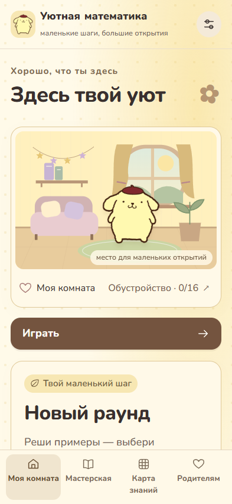
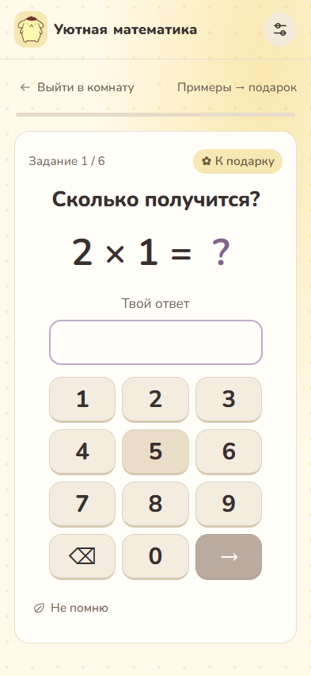
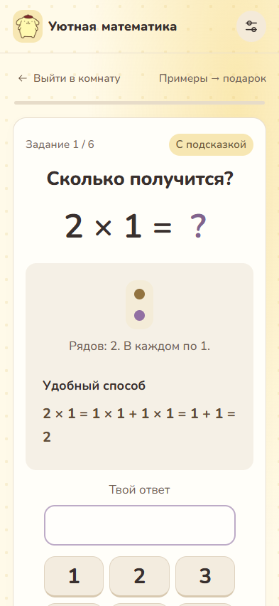
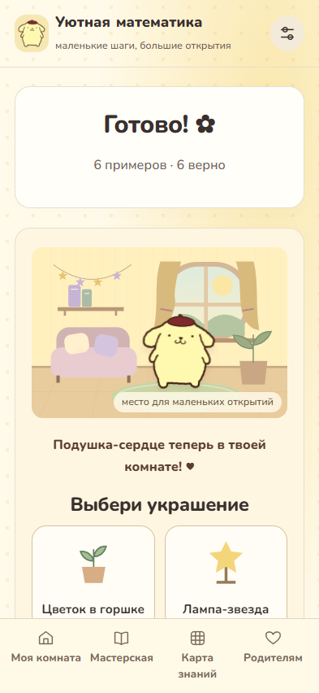

# Уютная математика · Cozy Math

[](https://github.com/wedelweg/uyutnaya-matematika/actions/workflows/ci.yml)

A Russian-language multiplication practice PWA with short rounds, optional explanations and a room to decorate.

**[Live demo](https://wedelweg.github.io/uyutnaya-matematika/)**

| Room                               | Practice                                   |
| ---------------------------------- | ------------------------------------------ |
|  |  |
| Help                               | Reward                                     |
|  |      |

## Features

- Short rounds of 4–8 questions, optional visual hints and separate step-by-step lessons.
- Correct-answer feedback and automatic advance; errors show a worked explanation.
- Collectible decorations, rearrangeable room items and two companion themes.
- Local progress, spaced review, knowledge map and parent statistics.
- Offline use after the initial cache completes; JSON backup/import and update prompts.

## Run locally

Node.js 24 and npm are required. No API keys, accounts or paid services.

```sh
npm ci && npm run dev
```

Open the URL printed by Vite with `/uyutnaya-matematika/` appended.

```sh
npm run lint
npm run typecheck
npm test
npm run build
npm run preview
npx playwright install chromium
npm run test:e2e
```

## How it works

React, TypeScript (strict mode), Vite, IndexedDB via `idb`, Workbox and vite-plugin-pwa.
Vitest covers learning logic, planning, rewards, storage and Russian plural forms.
Playwright exercises complete rounds, offline operation, persistence and responsive layouts.

The service worker precaches build assets under `/uyutnaya-matematika/`.
Updates are offered between sessions. Progress lives only in the current browser's
IndexedDB: no server, analytics or cross-device sync. Export a backup before clearing
browser storage. Browser eviction can remove local data.

Controls use accessible labels, keyboard focus styles, live feedback and reduced-motion
preferences. The interface has mobile layouts and tests for enlarged text; this is not
a claim of comprehensive accessibility certification. Browser tests cannot certify
physical iOS Home Screen installation. The embedded Apple touch icon is a compatibility
workaround whose result still depends on the device.

Review intervals are application rules, not evidence of this product's educational efficacy.

## Structure

- `src/domain/` — question planning, answer tracking and progression
- `src/features/` — practice, lessons, room and settings screens
- `src/storage/` — IndexedDB and validated backup import
- `src/pwa/` — offline cache and update lifecycle
- `tests/` — unit and browser scenarios
- `.github/workflows/` — CI and free GitHub Pages deployment

## Development and license

Built with AI-assisted development (Claude, Codex); all code reviewed and tested by the author.

Code: [MIT](LICENSE), © 2026 Andrii Trofimenko.
**Artwork is not MIT-licensed.** See [third-party notices](THIRD_PARTY_NOTICES.md)
for the retained Sanrio images and their unverified redistribution permission.

## По-русски

«Уютная математика» — тренажёр таблицы умножения: короткие раунды,
подсказки по запросу, уроки и украшение комнаты за занятия.

Запуск: `npm ci && npm run dev`. Интерфейс на русском языке.
Прогресс хранится только на устройстве. После первой загрузки и подтверждения
готовности приложение работает без интернета. Для переноса прогресса используйте
экспорт и импорт JSON. Демо размещено бесплатно на GitHub Pages.
